# CellWave

A cell-to-cell simulation matrix. Every cell holds a velocity, and each step advects that velocity into its neighbors, diffuses it, then adds noise, currents, emitters, and solid obstacles. The canvas paints the matrix directly: bright cells are slow, dark cells are fast.

[](https://github.com/newjordan/Cellwaves/actions/workflows/ci.yml)
[](https://opensource.org/licenses/MIT)
[](https://newjordan.github.io/Cellwaves/)

The simulation runtime is plain JavaScript. [Vite](https://vite.dev/) builds the page, and [Vitest](https://vitest.dev/) tests a single step of the matrix.

**GPU sibling:** [cellwaveGPU](https://github.com/newjordan/cellwaveGPU) is the WebGL2 version of this algorithm (Svelte 5 and OGL), with live controls and a snippet you can copy. The playground is at [cellwave-gpu.vercel.app](https://cellwave-gpu.vercel.app). This repository is the CPU matrix: the step runs in JavaScript so it can be read and tested without a GPU.

## Gallery

The controls panel, with the velocity matrix on the left. Auto mode steps the grid down when a device cannot hold the frame budget.

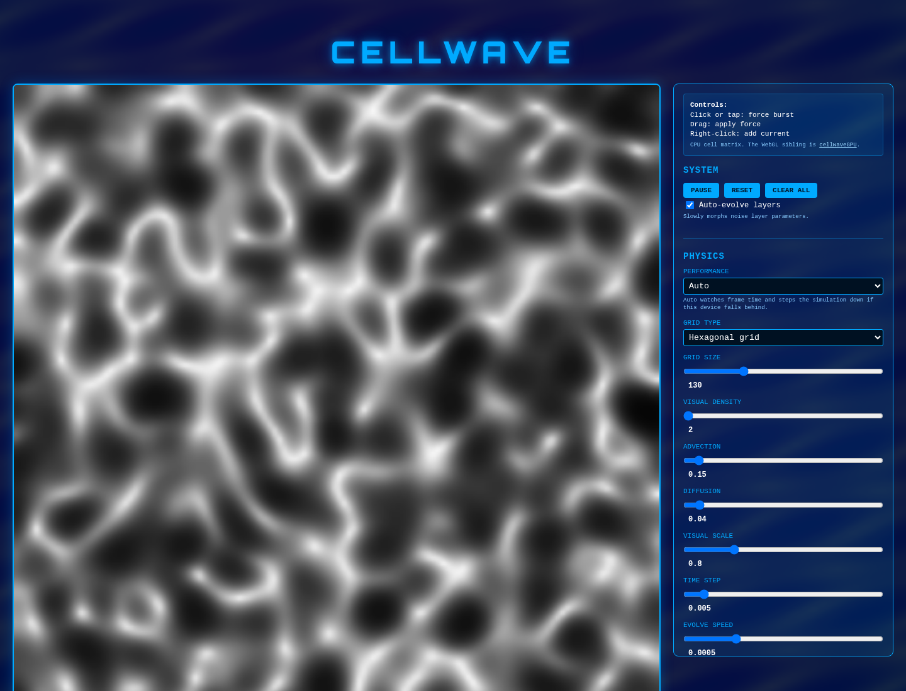

Animated square-grid flow, then still fields from the same painter. Bright is slow, dark is fast.

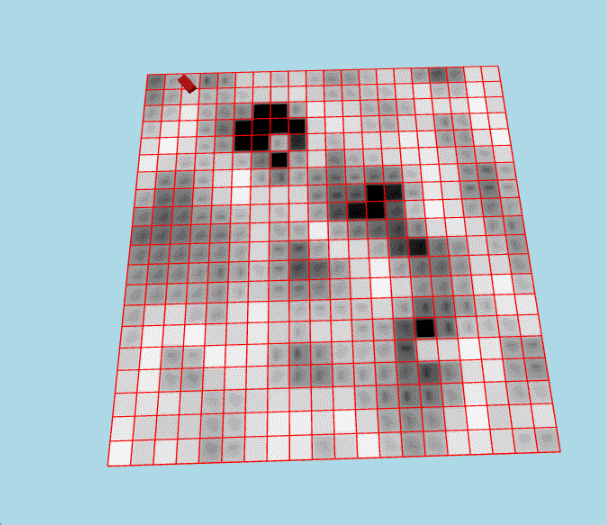

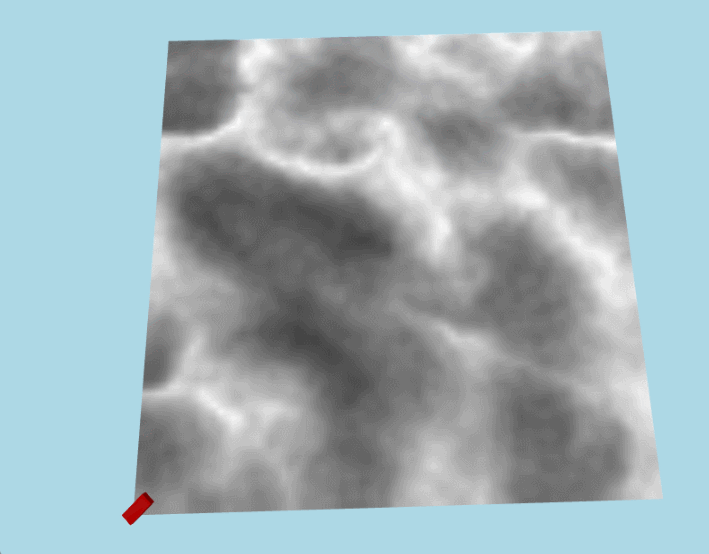

| | | |
| --- | --- | --- |
| 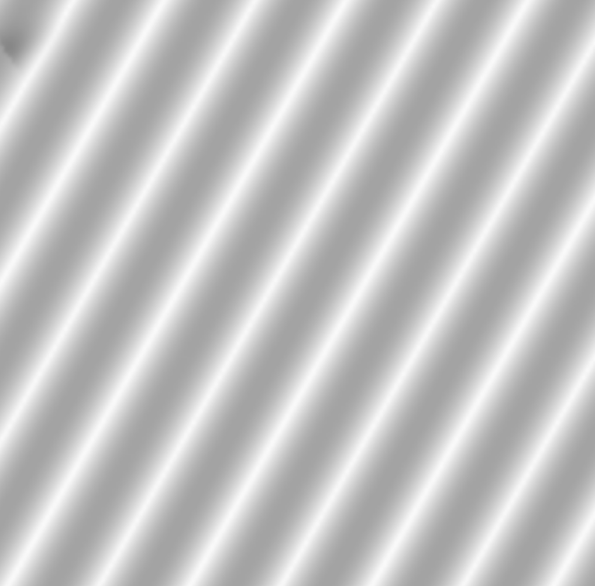 | 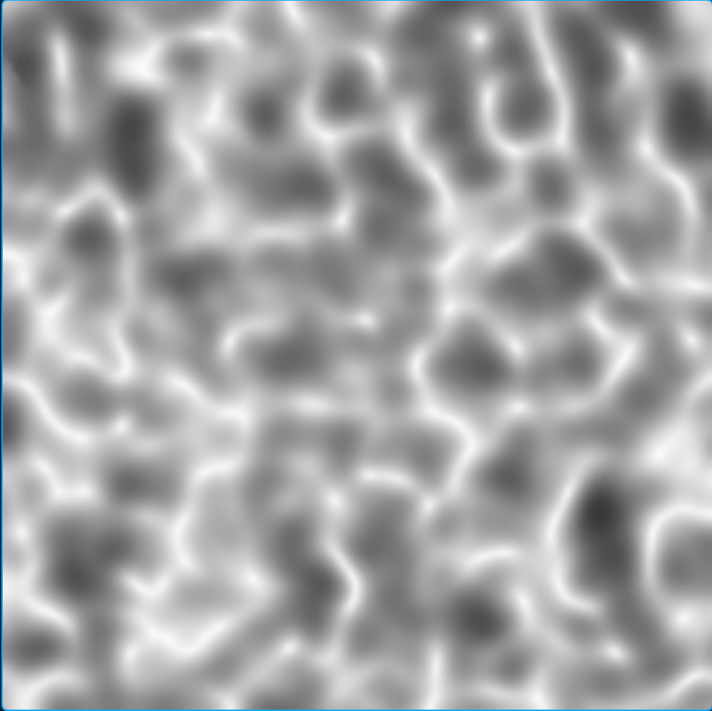 | 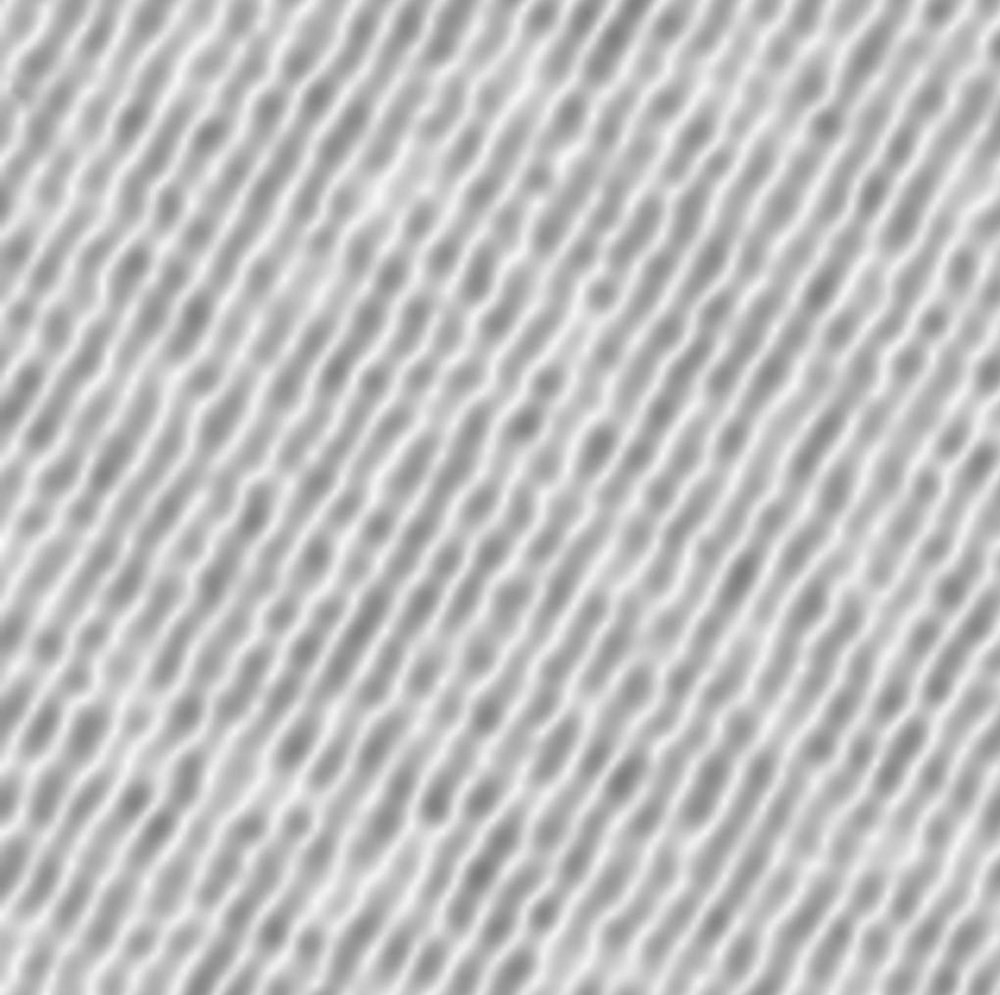 |
| Wave bands | Simplex turbulence | Fine interference |
| 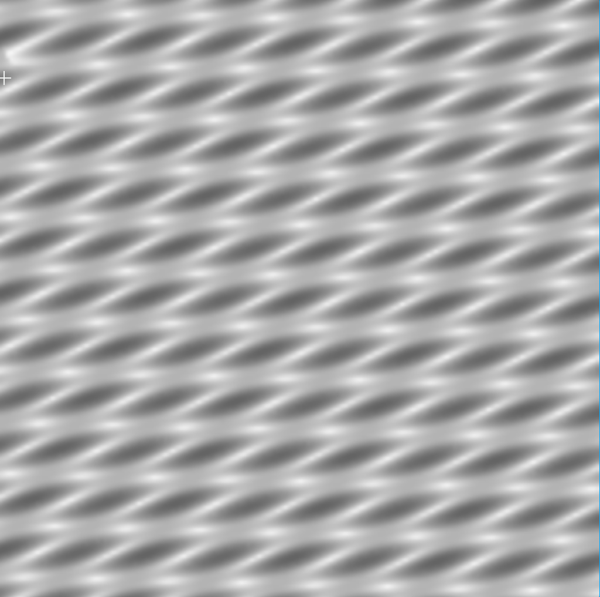 | 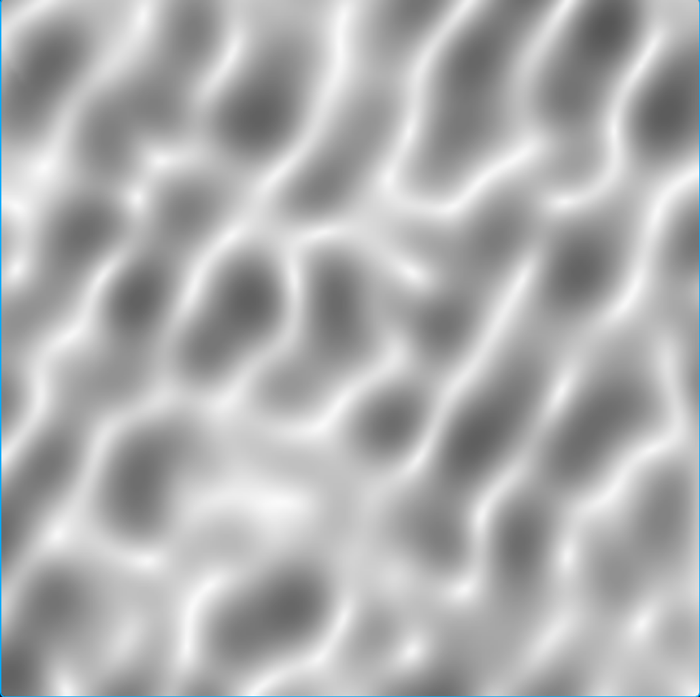 | 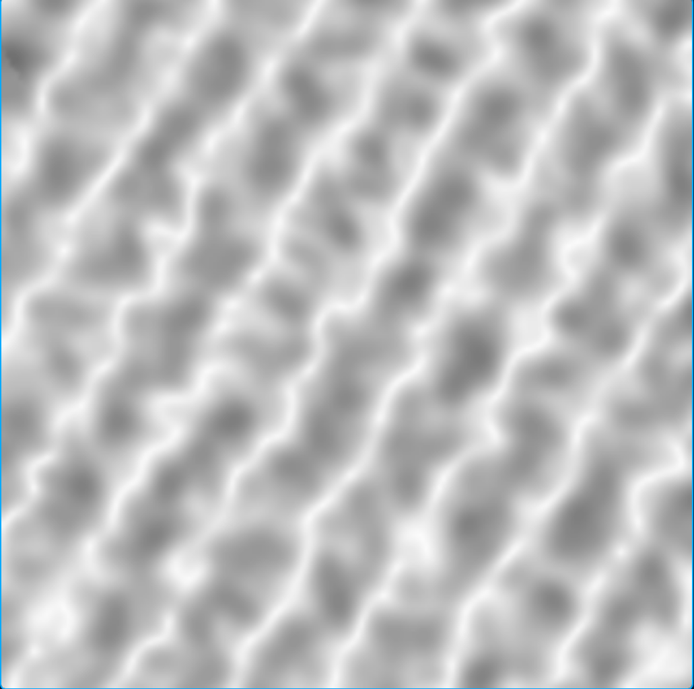 |
| Field study | Field study | Field study |
| 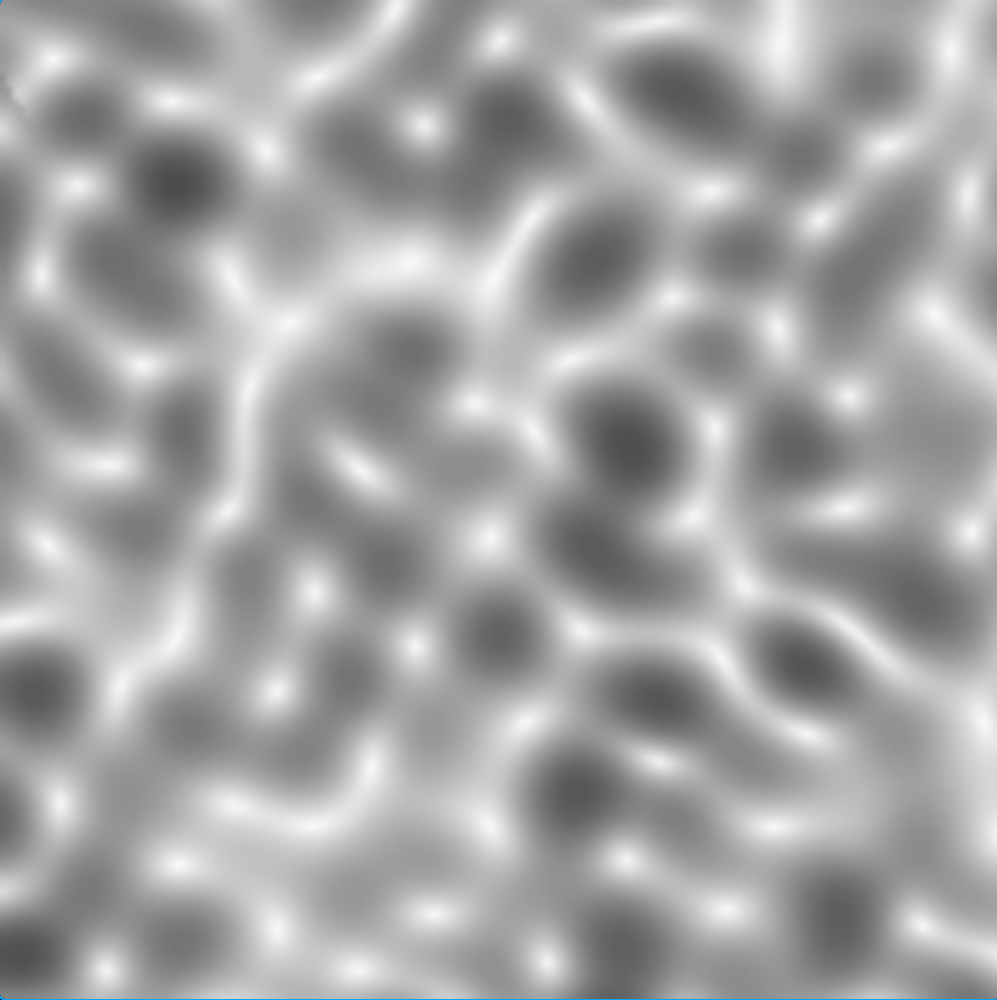 | 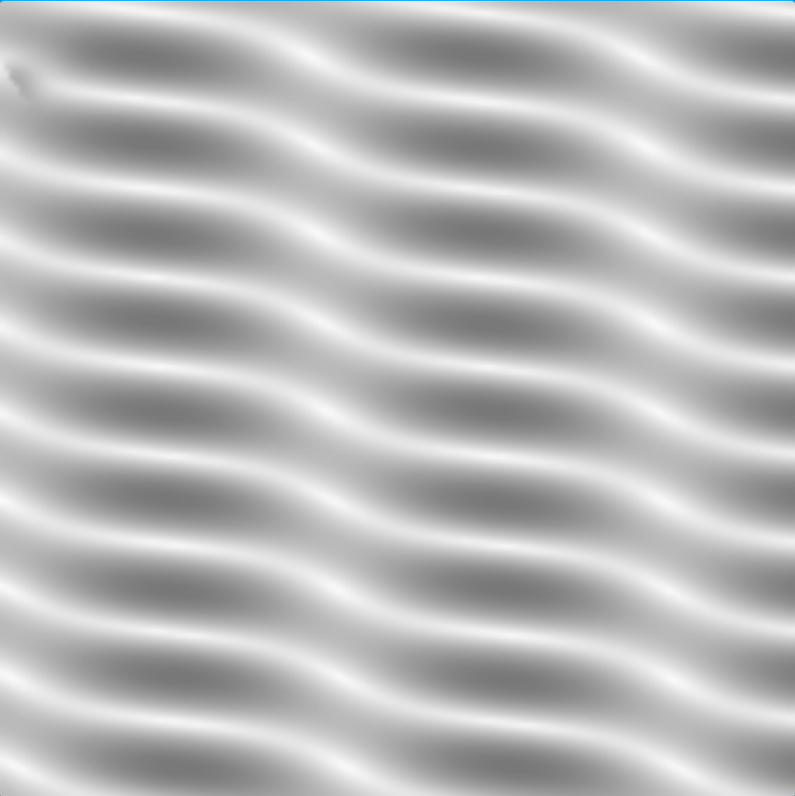 | 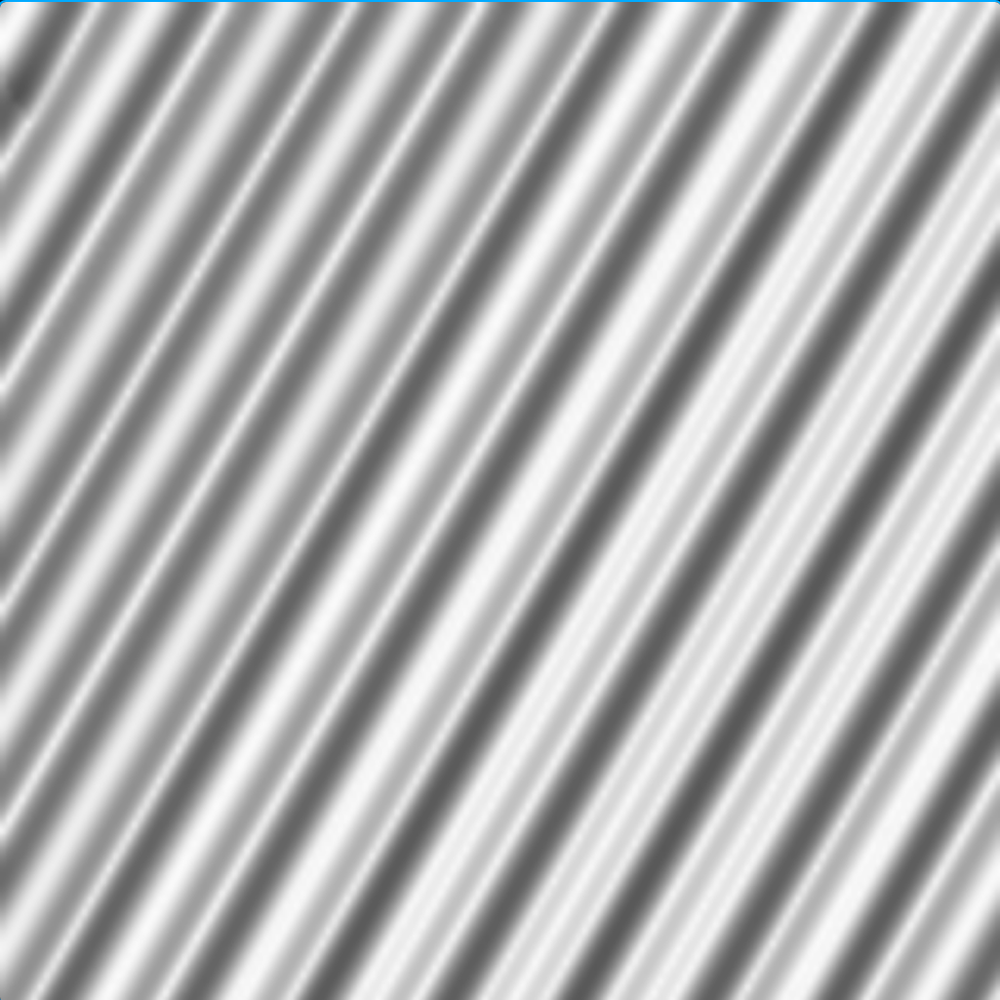 |
| Field study | Field study | Field study |

A short recording of the matrix is in [assets/screenshots/cellwave_1.mp4](assets/screenshots/cellwave_1.mp4).

## Run it

```bash
git clone https://github.com/newjordan/Cellwaves.git
cd Cellwaves
npm install
npm run dev
```

Open http://localhost:5173/.

```bash
npm test          # one simulation step, plus the performance fallback policy
npm run build     # static site in dist/
npm run preview   # serve that build
```

GitHub Actions runs the tests and the production build on every pull request. Pushes to `main` also deploy `dist/` to GitHub Pages. In the repository settings, set Pages → Build and deployment → Source to **GitHub Actions**. The published site is https://newjordan.github.io/Cellwaves/. The old `/demo/` path redirects to that root.

## Controls

- **Click or tap** for a force burst. **Drag** to push the field. **Right-click** to add a current.
- **Grid type** switches square (8 neighbors) and hexagonal (6 neighbors) without rebuilding the forces.
- **Grid size**, **visual density**, **advection**, **diffusion**, and **visual scale** are on the physics panel.
- **Time step** advances the noise and wave clock. **Evolve speed** is how fast auto-evolve morphs those layers. **Obstacle detail** is the quadtree depth used to draw solid cells.
- **Performance** is Auto, Quality, or Low power. Auto reads the device (core count, memory, data saver, reduced motion, small screens) and, if frames stay slower than about 30fps, lowers density, then the grid, then steps the simulation every second or third frame. Quality holds the resolution you picked.
- Each current, emitter, obstacle, and noise layer has its own sliders, including emitter taper and speed.

## How a step works

`CellWaveSimulator.updateFlow()` is one step:

1. **Occluders** zero any cell inside a rectangle.
2. **Advection** samples the cell upstream of the current velocity and keeps `advection` of that sample.
3. **Diffusion** adds a Laplacian. Square grids average 8 neighbors. Hex grids use `δH,Δ = (2/3h²) Σ(neighbor − center)`.
4. **Noise** adds simplex or wave forcing. `timeStep` moves the phase.
5. **Currents** add a tapered tube of force between two cells.
6. **Emitters** add a cone of force with length, spread, taper, and speed.

The painter writes one pixel per cell into an `ImageData` buffer, marks obstacle blocks, then scales that buffer up to the display canvas.

## Project layout

```
index.html                    page
src/cellwave-simulator.js     matrix step and painter
src/cellwave-app.js           controls, pointer input, frame loop
src/performance.js            slow-device policy
src/style.css
tests/simulation-step.test.js
public/demo/index.html        redirect from the old URL
.github/workflows/ci.yml
.github/workflows/pages.yml
assets/screenshots/
```

## API

```javascript
import { CellWaveSimulator } from './src/cellwave-simulator.js';

const simulator = new CellWaveSimulator(130, 2);
simulator.setGridSize(80);
simulator.setGridType(true); // hexagonal
simulator.advection = 0.9;
simulator.diffusion = 0.1;
simulator.visScale = 1;
simulator.timeStep = 0.005;

simulator.addCurrent({
  start: { x: 10, y: 10 },
  end: { x: 30, y: 30 },
  strength: 0.8,
  width: 2,
  taper: 1,
  speed: 1,
  curve: 0
});

simulator.addEmitter({
  x: 20, y: 20, angle: 45,
  strength: 1, length: 5, spread: 1.5,
  taper: 2, speed: 1, curve: 0
});

simulator.addOccluder({ type: 'rect', x0: 15, y0: 15, x1: 25, y1: 25 });

simulator.addNoiseLayer({
  scale: 20, strength: 0.5, speed: 1,
  enabled: true, pattern: 'simplex' // or 'wave'
});

simulator.updateFlow();
simulator.drawFlow();
```

`curve` is accepted on currents and emitters and stored with the force. The step does not bend the path with it.

## Performance

| Grid | Density | What to expect |
| --- | --- | --- |
| 60×60 | 2× | Starting size on a slow device |
| 130×130 | 2× | Default on a desktop |
| 200×200 | 2× | Noticeably heavier |
| 420×420 | 2× | Upper slider bound |

Auto mode will not stay on a size the machine cannot animate. Chrome and Firefox are the browsers this is exercised in. The page needs ES modules and canvas.

## References

- Hamilton, M.J., and Torin, D.J. (2014). [Discrete differential operators on hexagonal grids](https://doi.org/10.1016/j.jcp.2014.01.024). *Journal of Computational Physics*, 266, 161–179.
- Perlin, K. (2001). Noise hardware. *Real-Time Shading SIGGRAPH Course Notes*.
- Stam, J. (1999). [Stable Fluids](https://www.dgp.toronto.edu/public_user/stam/reality/Research/pdf/ns.pdf). *SIGGRAPH 99*.

## License

MIT. See [LICENSE](LICENSE).

The same algorithm on the GPU is [cellwaveGPU](https://github.com/newjordan/cellwaveGPU).
